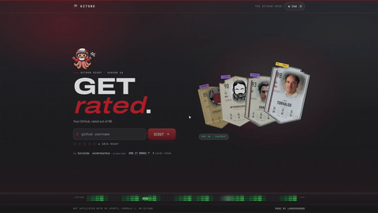

# gitone

your github, rated like f1.

gitone turns a public github profile into a driver card. exp, rac, awa and pac
come from real commits, prs and reviews. no survey, no self-reporting. the card
is a live png, re-scouted every two hours, and it can sit in any readme in one
line.

https://gitone.langersword.in

## media

<a href="https://gitone.langersword.in/torvalds">
  
</a>




[full 50s capture](public/demo/gitone-demo.mp4) ·
[product hunt launch](https://www.producthunt.com/posts/gitone)

## embed your card

```md
[](https://gitone.langersword.in/<login>)
```

| route | what it gives |
|---|---|
| `<host>/<login>.png` | live card, re-scouted every 2h |
| `<host>/<login>` | full scout report |
| `<host>/<login>/vs/<other>` | head-to-head duel |
| `/api/card/<login>` | raw json |

## how it works

```text
github graphql -> scout -> exp/rac/awa/pac -> rtg + finish + livery -> satori render -> kv/r2 cache -> live png
```

five decisions carry the product:

1. **scoring follows the f1 games.** rtg is pace-weighted. raw stats cap at 88,
   so the 90s stay a legacy gate. see `lib/racing/engine.ts`.
2. **the numbers come from github.** commits, prs and reviews are read from
   graphql. the card never asks the profile owner for a rating.
3. **one tree, two renderers.** the in-app card and the og png use the same
   layout through satori, so the embed cannot drift from the page.
4. **the 10ms cap never touches a cold render.** workers serve cached assets and
   branded fallbacks. off-path warmers write real pngs to r2.
5. **the driver number is permanent.** constructors carry their own livery and
   car spec from the headline language.

## run it

```bash
npm install --include=dev       # keep dev deps when NODE_ENV=production is set
printf 'GITHUB_TOKEN=ghp_xxx\n' > .env.local
npm run dev                     # http://localhost:3001
npm test                        # engine and duel suites
npm run build
```

for cloudflare workers, set `NEXT_PUBLIC_SITE_URL` to the live host. github
graphql needs a classic pat or `GITHUB_TOKENS` from distinct accounts.

## stack

| dependency | version | job |
|---|---:|---|
| next | 16.4.6 | app router and server routes |
| react | 19.2.4 | ui tree |
| typescript | 5.x | one typed model for page and og card |
| tailwind css | 4 | styling |
| gsap | 3.15.1 | motion |
| vitest | 4.1.9 | tests |
| opennext cloudflare | 1.20.17 | worker deployment |

## credits

inspired by [gitfut](https://github.com/mawsis/gitfut), the football card
original. not affiliated with ea sports, formula 1 or github. mit licensed.
rook is the non-blocking automated reviewer, documented in
[docs/ROOK_REVIEW.md](docs/ROOK_REVIEW.md).

if this was worth your five minutes, a star is the whole ask.
